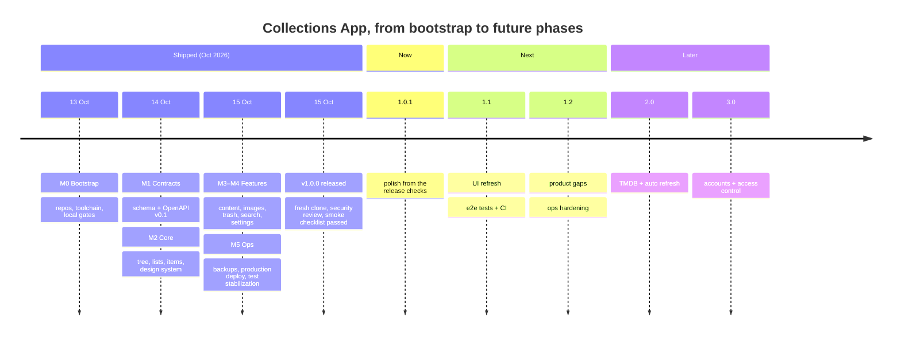
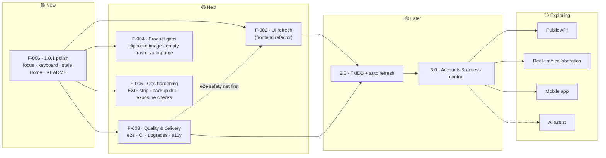

# Collections App — Product Roadmap

| | |
|---|---|
| **Owner** | Top-level orchestrator (parent repo session), approved by the product owner (you) |
| **Last updated** | 2026-10-15 |
| **Horizons** | **Now**: in flight · **Next**: committed, starts when Now is done · **Later**: committed phases, not scheduled · **Exploring**: ideas, no commitment |
| **Status** | ✅ shipped · 🟢 in progress · 🟡 planned · ⚪ idea · ⛔ not doing |

Target windows are **indicative**, not promises. Order within a horizon is the priority order.
Each initiative with an ID (`F-NNN`) has a feature brief in [`design-docs/features/`](design-docs/features/) once it reaches **Next**.

---

## 1. Vision

A calm, image-forward place for two people to collect and compare the things they like or want: movies to watch,
motorcycles to consider, things to buy. It's private and self-hosted on a home server. Data is never lost: there's
version history, a trash with restore, and backups. It should be quick to use on a phone or a desktop.

**Product principles**
1. **Private by default.** The app is never exposed to the internet without accounts (Phase 3). Data stays on your hardware.
2. **Never lose user data.** Edits are versioned, deletes are restorable, conflicts never discard a draft, and backups are verified.
3. **Calm and lean.** Clean UI, few dependencies, no features that need maintenance without being used.
4. **Contract first.** The backend owns the OpenAPI contract, and the web app follows a pinned version.

---

## 2. At a glance

| Release | Theme | Status | Window |
|---|---|---|---|
| **1.0 MVP** | Organize, describe and protect a shared collection | ✅ Released `v1.0.0` (2026-10-15) | Oct 2026 |
| **1.0.1** | Polish: C4 and Q-05 findings | 🟡 Next (first v2 feature) | Oct 2026 |
| **1.1** | UI refresh + quality and delivery | 🟡 Next | Q4 2026 |
| **1.2** | Small product gaps and ops hardening | 🟡 Next | Q4 2026 – Q1 2027 |
| **2.0** | Movies come alive: TMDB lookup and automatic refresh | 🟡 Later | Q1 2027 |
| **3.0** | Accounts and access control (required before any exposure) | 🟡 Later | 2027 |
| — | Public API, AI features, real-time collaboration, mobile app | ⚪ Exploring | — |

---

## 3. Now / Next / Later

**Why this order.**
1.0 ships first. The UI refresh comes right after, because the product works and the next big lever is how it *looks*.
End-to-end tests (F-003) ideally land first, so the refactor has a safety net. TMDB (2.0) builds on the refreshed UI. Accounts (3.0) gate everything that goes beyond two people on a private network.

---

## 4. Shipped: 1.0 MVP (`v1.0.0`, 2026-10-15)

| Area | What you can do | Backend | Web |
|---|---|---|---|
| Organize | Nested folders, lists at the root or in folders, move with cycle protection, drag-reorder | B-06 | W-04, W-05 |
| Items | 6 kinds (generic, movie, TV show, motorcycle, car, camera) with optional per-kind fields, sort, filter, 3 display modes | B-07 | W-06, W-07, W-08 |
| Descriptions | Markdown editor with safe preview, version history and restore | B-08 | W-10 |
| Images | One per item: upload or URL, thumbnails, progress, orphan cleanup | B-09 | W-09 |
| Find | Title search with paths, Home with recent items | B-11, B-12 | W-11, W-13 |
| Undo | Trash with batch restore, restore-to, and purge | B-10 | W-12 |
| Two editors | Optimistic concurrency: conflicts never discard a draft | B-04 | W-08 |
| Look & feel | Design system, light and dark themes, responsive shell from 375 px | — | W-03, W-04, W-13 |
| Run it | `./deploy/dev`, `./deploy/test`, `./deploy/prod` (home server, images built locally, loopback/Tailscale only) | Q-03 | Q-03w |
| Protect it | Backup, restore and verify of Postgres and images together, with retention | Q-02 | — |

Contract: `api-v0.2.0`. Decisions D-001 to D-073 are in [`design-docs/DECISIONS.md`](design-docs/DECISIONS.md).

---

## 5. Now

### F-006 · 1.0.1 polish 🟢 (draft, waiting for your OK)
Small fixes found by the 1.0 checks and by you, all in the web app: Home and Trash go stale after a delete until reload; the
"Backend: ready" indicator moves into Settings (with the API address and contract version); Tab
reachability of the sidebar tree; focus return after Esc; delete-confirm vs Trash counts; a client-side IMDb URL check;
an up-to-date web README; a flaky `ItemEditForm` test; the prod CSP verified in a real browser.
Brief: [`design-docs/features/F-006-1.0.1-polish.md`](design-docs/features/F-006-1.0.1-polish.md). It's the first feature
run with the v2 workflow, after F-000 installs the v2 agents.

### F-001 · 1.0 release readiness ✅
Fresh-clone check (Q-04), scope and security review (Q-05: no critical or high findings), smoke checklist (C4: 13/13
manual items pass, backup/restore covered by the automated round trip). Tagged `v1.0.0`.

## 6. Next

### F-002 · UI refresh (frontend refactor) 🟡 · 1.1
**What:** a large, mostly **aesthetic** refactor of the web app: a new visual design applied across every screen.
Behavior and the API stay as they are.

**Status:** the design is still to come. You'll provide it, and only then does this become a feature brief with
user stories (D-075). Until then, nothing about mood, colors, typography or layout is decided.

**Guardrails that apply whatever the design:**
- Lean (D-034): no heavy UI kits, and the bundle shouldn't grow without a reason.
- Accessibility holds: both themes stay at zero axe violations, with keyboard paths intact.
- Behavior doesn't change, and the existing test suite stays green. F-003's end-to-end tests make a good safety net first.

### F-003 · Quality & delivery 🟡 · 1.1
- **End-to-end tests** with Playwright + axe against the real backend (deferred Q-01a/Q-01b, D-068). These are the safety net for F-002.
- **CI comes back** (D-031 deferred it): GitHub Actions running `make check` / `npm run check` on PRs, plus Dependabot. Branch protection only if the plan allows.
- **Toolchain upgrades:** Node 26 when it becomes LTS (2026-10-28, D-042); TypeScript 7 once typescript-eslint supports it (D-040).
- **Accessibility follow-ups:** VoiceOver pass on drag-and-drop announcements; a keyboard context menu (Shift+F10) on tree rows (W-05).
- **Dev ergonomics:** verify the `VITE_API_MOCKS=1` mock mode in a real browser (W-02).

### F-004 · Product gaps 🟡 · 1.2
Small, high-value items from the deferred list (PRODUCT §13):
- Paste an image from the clipboard onto an item.
- "Empty trash", with confirmation.
- Optional trash auto-purge after N days (setting, off by default).

### F-005 · Ops hardening 🟡 · 1.2
- Strip EXIF metadata (GPS) from uploaded originals (B-09 to-do, DATA_MODEL §9).
- Your own backup → wipe → restore drill on the dev stack (open since Q-02), unless done in F-006.
- `make audit` / `npm run audit` before each release tag (Q-05: one x/crypto advisory with no fix yet, not called).
- A scheduled backup on the Pi, plus a documented quarterly restore drill.
- An exposure check for the local stack too (today it covers only backend and prod compose).
- Big-image (40 MP) and slow-network upload checks in the UI (W-09 not checked).

---

## 7. Later (committed phases)

### 2.0 · TMDB + automatic refresh 🟡
Movie and TV lookup when creating an item, metadata refresh, streaming availability by country (uses the existing
`streaming_country_code` setting), proper attribution, and rate limits. **User-entered values are never silently
overwritten.** No IMDb scraping. Starts with a check of current TMDB terms. Seams already exist: per-kind validator
registry and `metadata` JSONB (ARCHITECTURE §7).

### 3.0 · Accounts & access control 🟡
Users, memberships, authorization; every table already carries `workspace_id` for this (revisit `item_content_versions`, which
relies on item-level workspace checks, Q-05 finding 5). **This is the gate before any
exposure beyond the private network.**

---

## 8. Exploring (no commitment)

| Idea | Notes |
|---|---|
| Public API | Needs a full re-discussion first (PRODUCT §13, Phase 4) |
| Real-time collaborative Markdown | Path kept open: Yjs + CodeMirror 6, content already versioned in Postgres (ARCHITECTURE §7) |
| Mobile app | Same pinned OpenAPI contract, separate repo |
| AI assist | Description drafts, comparisons, Q&A. Only with explicit approval before anything is saved. Very distant |
| Multiple images per item | `attachments` is already independent of `items`, so it's additive |
| Advanced search | Search inside Markdown and metadata, saved filters |
| Offline mode, rich-text editor, version diffs, custom workflows | Deferred since the MVP, no current demand |
| Comparison view | Side by side of 2–4 items in a list (fits "things we are comparing") |

## 9. Not doing ⛔
- Exposing the app to the internet before 3.0.
- A monorepo, microservices, Redis, queues, an ORM (ORCHESTRATOR_BRIEF §2).
- Scraping IMDb or any provider that doesn't allow it.

## 10. Open questions
| ID | Question | Default |
|---|---|---|
| Q-4 | License for the repos? | No LICENSE (all rights reserved) |

---

## How this roadmap is maintained
- The **top-level orchestrator** (a session in this parent repo) owns this file. It turns an initiative into a feature brief
  in `design-docs/features/F-NNN-*.md` with user stories per repo, when it moves to **Next** and you approve it.
- The **repo orchestrators** split stories into tasks and run them with internal worker agents
  ([`design-docs/AGENT_WORKFLOW.md`](design-docs/AGENT_WORKFLOW.md) §1b). Progress is tracked in [`design-docs/STATUS.md`](design-docs/STATUS.md).
- This file is updated when a feature ships, starts, or changes horizon. Detailed task history stays in STATUS.md.

## Changelog
- 2026-10-15: **v1.0.0 released.** Workflow v2 started. F-006 (1.0.1 polish) is Now; F-001 done.
- 2026-10-15: Q-04 done. F-002 made generic: the design comes from you later (D-075). The v2 workflow starts after Q-05 + C4.
- 2026-10-15: Roadmap created. 1.0 feature-complete; F-001 to F-005 defined; UI refresh (F-002) added.
