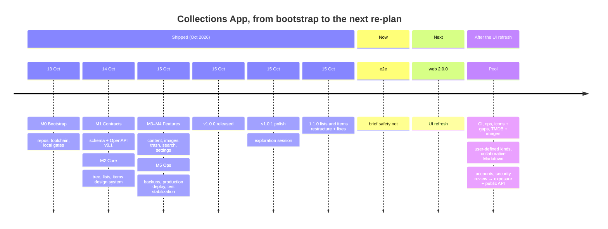
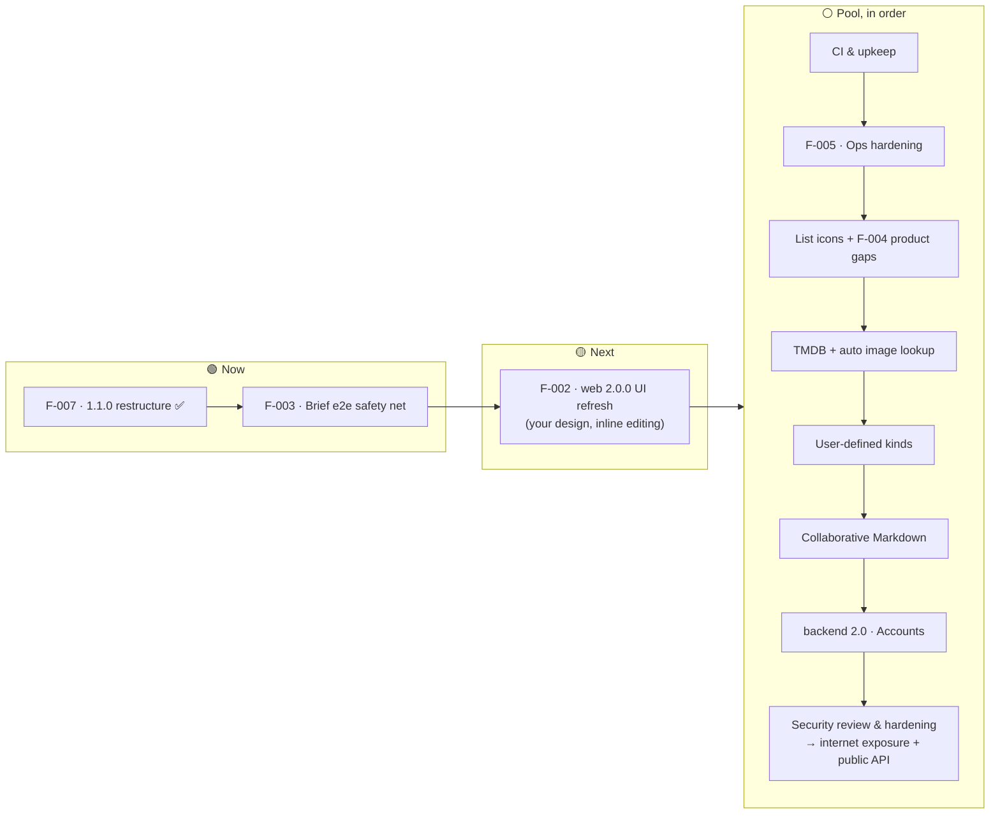

# Collections App — Product Roadmap

| | |
|---|---|
| **Owner** | Top-level orchestrator (parent repo session), approved by the product owner (you) |
| **Last updated** | 2026-10-15 |
| **Horizons** | **Now**: in flight · **Next**: committed, in order · **Pool**: committed, proposed order fixed at the next re-plan · **Future**: on the roadmap, not ordered · **Exploring**: uncertain concepts, no commitment |
| **Status** | ✅ shipped · 🟢 in progress · 🟡 planned · ⚪ idea · ⛔ not doing |

Target windows are **indicative**, not promises. Order within a horizon is the priority order.
Each initiative with an ID (`F-NNN`) has a feature brief in [`design-docs/features/`](design-docs/features/) once it reaches **Next**.
IDs follow creation order, not execution order: the **#** column in §2 is the order things run in.

---

## 1. Vision

A calm, image-forward place for two people to collect and compare the things they like or want: movies to watch,
motorcycles to consider, things to buy. It's private and self-hosted on a home server. Data is never lost: there's
version history, a trash with restore, and backups. It should be quick to use on a phone or a desktop.

**Product principles**
1. **Private by default.** The app is never exposed to the internet before accounts and a thorough security review and hardening. Data stays on your hardware.
2. **Never lose user data.** Edits are versioned, deletes are restorable, conflicts never discard a draft, and backups are verified.
3. **Calm and lean.** Clean UI, few dependencies, no features that need maintenance without being used.
4. **Contract first.** The backend owns the OpenAPI contract, and the web app follows a pinned version.

---

## 2. At a glance

| # | Release | Theme | Status | Window |
|---|---|---|---|---|
| — | **1.0 MVP** | Organize, describe and protect a shared collection | ✅ Released `v1.0.0` (2026-10-15) | Oct 2026 |
| 1 | **1.0.1** | Polish from the release checks (F-006) | ✅ Released `v1.0.1` (2026-10-15) | Oct 2026 |
| 2 | — | Exploration session: you used the fresh test env and listed what to change | ✅ Done (2026-10-15) | Oct 2026 |
| 3 | **1.1.0** | Lists and items restructure + exploration fixes (F-007): one kind per list, trimmed fields, addable price, list description, 6 UI fixes. Last shared version (D-080) | ✅ Released `v1.1.0` (2026-10-15) | Oct 2026 |
| 4 | — | Brief e2e safety net (F-003): `make smoke` + ~8 Playwright specs | ✅ Done (2026-10-15) | Oct 2026 |
| 5 | **web 2.0.0** | UI refresh (F-002): Frosted Gallery design, in-place item editing, quick add, streaming icons; run from a sister session | 🟢 Now (design being refined, brief is a draft) | Q4 2026 |
| — | later | Pool, in this order: CI and upkeep → ops hardening → list icons + product gaps → TMDB + auto images → user-defined kinds → collaborative Markdown → accounts (backend 2.0) → security review → internet exposure + public API | ⚪ Pool | 2027 |
| — | future | List import, advanced search | 🔭 Future | — |

---

## 3. Now / Next / Pool

**Why this order.**
The restructure (F-007) changes the data model and the screens built on it: list types, item forms and list pages. Doing it
first means the e2e tests and the UI refresh are written once, against the final shape, not twice. The e2e tests come right
before the UI refresh because they're its safety net. Everything else waits for a re-plan after the UI refresh, when the app has its
final shape and look.

---

## 4. Shipped: 1.0 MVP (`v1.0.0`, 2026-10-15)

| Area | What you can do | Backend | Web |
|---|---|---|---|
| Organize | Nested folders, lists at the root or in folders, move with cycle protection, drag-reorder | B-06 | W-04, W-05 |
| Items | 6 kinds (generic, movie, TV show, motorcycle, car, camera) with optional per-kind fields, sort, filter, 3 display modes | B-07 | W-06, W-07, W-08 |
| Descriptions | Markdown editor with safe preview, version history and restore | B-08 | W-10 |
| Images | One per item: upload or URL, thumbnails, progress, orphan cleanup | B-09 | W-09 |
| Find | Title search with paths, Home with recent items | B-11, B-12 | W-11, W-13 |
| Undo | Trash with batch restore, restore-to, and purge | B-10 | W-12 |
| Two editors | Optimistic concurrency: conflicts never discard a draft | B-04 | W-08 |
| Look & feel | Design system, light and dark themes, responsive shell from 375 px | — | W-03, W-04, W-13 |
| Run it | `./deploy/dev`, `./deploy/test`, `./deploy/prod` (home server, images built locally, loopback/Tailscale only) | Q-03 | Q-03w |
| Protect it | Backup, restore and verify of Postgres and images together, with retention | Q-02 | — |

Contract: `api-v0.2.0`. Decisions D-001 to D-073 are in [`design-docs/DECISIONS.md`](design-docs/DECISIONS.md).

---

## 5. Now

### F-003 · Brief e2e safety net ✅
`make smoke` on the backend (one HTTP pass over the running stack) and about 8 Playwright specs on the web (organize,
item with price, description history, image, conflict, trash, search and links, a reduced axe pass in both themes).
Not part of the gate; run on user-flow changes and before a release (D-076). Lean workflow (D-081).
Brief: [`design-docs/features/F-003-e2e-safety-net.md`](design-docs/features/F-003-e2e-safety-net.md).

### F-007 · Lists and items restructure + exploration fixes ✅ · 1.1.0
Merged 2026-10-15 (backend#18, web#28, `api-v0.3.0`). One kind per list (no per-item kind), common fields trimmed to title, image, website and description,
price addable on demand (single or range), essential kind fields with a per-kind sort key, Markdown list description, and
the 6 exploration fixes (no "collections" wording, folder rows without arrow, no move up/down on folders, one description,
no breadcrumbs, appearance toggle in the sidebar). Contract `api-v0.3.0`. Run with the one-off lean workflow (D-079).
Both repos ship **1.1.0**, the last shared version (D-080).
Brief: [`design-docs/features/F-007-lists-items-restructure.md`](design-docs/features/F-007-lists-items-restructure.md).

### Exploration session ✅
You used `./deploy/test` (fresh) and listed what to change; the findings went into F-007, the rest into F-002 and the pool.

### F-006 · 1.0.1 polish ✅
Small fixes found by the 1.0 checks and by you, all in the web app: Home and Trash go stale after a delete until reload; the
"Backend: ready" indicator moves into Settings (with the API address and contract version); Tab reachability of the
sidebar tree; focus return after Esc; delete-confirm vs Trash counts; a client-side IMDb URL check; an up-to-date web
README; a flaky `ItemEditForm` test; the prod CSP verified in a real browser.
Brief: [`design-docs/features/F-006-1.0.1-polish.md`](design-docs/features/F-006-1.0.1-polish.md). The first feature run
with the v2 workflow.

### F-001 · 1.0 release readiness ✅
Fresh-clone check (Q-04), scope and security review (Q-05: no critical or high findings), smoke checklist (C4). Tagged `v1.0.0`.

## 6. Next (in this order)

### F-002 · UI refresh 🟢 · web 2.0.0
**Status 2026-10-15:** design direction **Frosted Gallery** chosen (Apple-inspired, layered, plain colour) and the brief drafted (not approved yet, design still being refined): [`design-docs/features/F-002-ui-refresh.md`](design-docs/features/F-002-ui-refresh.md) (stories per repo; one backend story for paid streaming platforms, the rest web). The inputs below are all folded into it.

**What:** a large refactor of the web app: a new visual design applied across every screen, plus the interaction changes
below. The API stays as it is unless the design needs something small. The web becomes 2.0.0; the backend keeps its own
version (D-080). The design comes from you (D-075).

**Run from a separate session:** the UI rework is designed, planned and orchestrated from a sister top-level session in this
same folder, which drives its own web/backend sessions. This main session doesn't plan or start it; it only keeps this
section and the roadmap current.

**Inputs collected so far (from you, 2026-10-15):**
- **No edit mode at all.** An item is edited directly in its side page (the item detail panel): no separate "Edit" panel,
  no big form with every field. Each field shows a small pen in its top-right corner on hover and is edited in place; the
  Markdown description is edited by selecting it in the page; "+" adds a field that isn't shown yet (e.g. price, as a single
  price or a range, F-007).
- **Drag folders and lists from anywhere on the row**, without the six-dot grip handle.
- Already done in F-007 (keep them): no "collections" wording, folder rows without the expand arrow (folder icon opens and
  closes), no move up/down on folders, one description shown only in the item detail, no breadcrumbs, the appearance toggle
  in the sidebar.
- Known follow-ups from F-007 the redesign can absorb: the list kind is changed from the Rename dialog (not an obvious
  place); a single price renders as `€1,200`.

**Guardrails that apply whatever the design:**
- Lean (D-034): no heavy UI kits, and the bundle shouldn't grow without a reason.
- Accessibility holds: both themes stay at zero axe violations, with keyboard paths intact (in-place editing and
  drag-from-anywhere need keyboard equivalents).
- Behavior changes only where listed above. The unit tests and the F-003 e2e tests stay green; specs that drive the old
  edit form (item, conflict AT-09, unsaved-changes guard AT-22) are updated to the in-place editing, not dropped.

## 7. Pool (in order, after the UI refresh)

Committed, in this order (set by you, 2026-10-15), after the UI refresh. The re-plan after F-002 only adjusts it if needed. Web and backend version independently (D-080).

| # | Initiative | What | Likely version |
|---|---|---|---|
| 1 | **CI & upkeep** | GitHub Actions running the gates + Dependabot (D-031 deferred it); Node 26 LTS (from 2026-10-28, D-042) and TypeScript 7 when typescript-eslint supports it (D-040); VoiceOver pass on drag-and-drop and a keyboard context menu on tree rows (W-05); verify `VITE_API_MOCKS=1` in a browser (W-02) | no user-facing bump |
| 2 | **F-005 · Ops hardening** | Strip EXIF (GPS) from uploads; your backup → wipe → restore drill (moved from F-006 U1); `make audit` / `npm run audit` before each tag; scheduled backup on the Pi plus a quarterly restore drill; exposure check for the local stack; 40 MP and slow-network upload checks | backend 1.1.x |
| 3 | **List icons + F-004 product gaps** | An interchangeable icon per list: an emoji or one from a built-in icon set (Notion-style, no photos), the current icon as default. Paste an image from the clipboard (copy an image or take a screenshot, then Cmd+V on an item to set it as its image, without saving a file first); "Empty trash" with confirmation; optional trash auto-purge after N days (off by default) | backend 1.2 / web 2.1 |
| 4 | **TMDB + automatic image lookup** | Movie and TV lookup when creating an item, metadata refresh, streaming availability by country, attribution, rate limits; an image fetched automatically when an item is added (TMDB for movies and TV, another provider to check for the other kinds). User-entered values are never silently overwritten. No IMDb scraping. Starts with a check of the providers' terms | backend 1.3 / web 2.2 |
| 5 | **User-defined kinds** | Create your own item types with custom fields and a sort key. Fits the validator registry + `metadata` JSONB, but needs kind definitions stored per workspace | backend 1.4 / web 2.3 |
| 6 | **Real-time collaborative Markdown** | Two people editing the same description live. Path kept open: Yjs + CodeMirror 6, content already versioned in Postgres (ARCHITECTURE §7) | backend 1.5 / web 2.4 |
| 7 | **Accounts & access control** | Users, memberships, authorization; every table already carries `workspace_id` (revisit `item_content_versions`, Q-05 finding 5) | **backend 2.0** / web 3.0 |
| 8 | **Security review & hardening → internet exposure + public API** | A thorough security review and hardening pass (threat model, auth/session review, rate limiting, headers, dependency and container audit, pentest-style checks). Internet exposure and a public API happen only after it, or within it. The public API needs a full re-discussion first (PRODUCT §13, Phase 4) | after backend 2.0 |

## 8. Future (on the roadmap, not yet ordered)

| Idea | Notes |
|---|---|
| List import | Create a list from text, e.g. a Markdown bullet list (one item per bullet). Format and rules to be defined |
| Advanced search | Search inside Markdown descriptions and kind fields, saved filters |

## 9. Exploring and not on the roadmap

**Exploring (a possible new concept, not sure yet):**
| Idea | Notes |
|---|---|
| Compare & AI assist | A separate, future concept: side-by-side comparison of 2–4 items, with AI help (drafts, comparisons, Q&A) only with explicit approval before anything is saved. To be defined from scratch, if ever |

**Not on the roadmap for now:**
- **Mobile app.** Only after accounts and once the app is public; same pinned OpenAPI contract, separate repo.
- **Multiple images per item.**
- Offline mode, rich-text editor, version diffs, custom workflows (deferred since the MVP, no demand).

**Not doing ⛔**
- Exposing the app to the internet, or publishing an API, before the security review and hardening (pool item 8), which itself comes after accounts.
- A monorepo, microservices, Redis, queues, an ORM (ORCHESTRATOR_BRIEF §2).
- Scraping IMDb or any provider that doesn't allow it.

## 10. Open questions
| ID | Question | Default |
|---|---|---|
| Q-4 | License for the repos? | No LICENSE (all rights reserved) |

---

## How this roadmap is maintained
- The **top-level orchestrator** (a session in this parent repo) owns this file. It turns an initiative into a feature brief
  in `design-docs/features/F-NNN-*.md` with user stories per repo, when it moves to **Next** and you approve it.
- The **repo orchestrators** split stories into tasks and run them with internal worker agents
  ([`design-docs/AGENT_WORKFLOW.md`](design-docs/AGENT_WORKFLOW.md) §1b). Progress is tracked in [`design-docs/STATUS.md`](design-docs/STATUS.md).
- This file is updated when a feature ships, starts, or changes horizon. Detailed task history stays in STATUS.md.

## Changelog
- 2026-10-15: **v1.1.0 released** (parent + web tags; backend tagged earlier). **F-003 done** (backend#19 `make smoke`, web#29 Playwright). F-002 UI rework is Now, in a sister session (design first).
- 2026-10-15: **Pool order set by you:** UI refresh → CI & upkeep → ops hardening → list icons + gaps → TMDB + auto images → user-defined kinds → collaborative Markdown → accounts → security review. List import moves to Future. F-002 gets the inputs collected so far (no edit mode, edit in the item side page) and is run from a sister session.
- 2026-10-15: **Pool re-shaped.** Proposed order: CI & upkeep → ops hardening → list icons + gaps → TMDB + auto images → list import → user-defined kinds → collaborative Markdown → accounts (backend 2.0) → security review & hardening, which gates internet exposure and the public API. Advanced search is Future. Compare + AI assist becomes one uncertain future concept. Mobile app and multiple images per item are off the roadmap for now.
- 2026-10-15: **F-007 merged** (1.1.0, `api-v0.3.0`); PRODUCT and DATA_MODEL updated. **F-003 approved and Now**: `make smoke` + ~8 Playwright specs, lean workflow (D-081).
- 2026-10-15: **Exploration done, F-007 approved** (1.1.0, Now): restructure + 6 UI fixes, one-off lean workflow (D-079). Versions diverge after 1.1.0: UI refresh = web 2.0.0, TMDB stays backend 1.x, accounts = backend 2.0 (D-080). Pool gains list icons and automatic image lookup; F-002 gains inline editing and drag-from-anywhere; user-defined kinds in Exploring.
- 2026-10-15: **v1.0.1 released** (F-006 polish); the exploration session starts. Backup drill (U1) moved to F-005.
- 2026-10-15: **Re-plan.** Next is now, in order: exploration session → F-007 lists and items restructure (1.1) → brief e2e (F-003, cut to e2e only) → UI refresh (F-002, 1.2). List import added. F-004, F-005, CI and upkeep, 2.0 and 3.0 move to a pool ordered after 1.2 (D-078).
- 2026-10-15: **v1.0.0 released.** Workflow v2 started. F-006 (1.0.1 polish) is Now; F-001 done.
- 2026-10-15: Q-04 done. F-002 made generic: the design comes from you later (D-075). The v2 workflow starts after Q-05 + C4.
- 2026-10-15: Roadmap created. 1.0 feature-complete; F-001 to F-005 defined; UI refresh (F-002) added.
