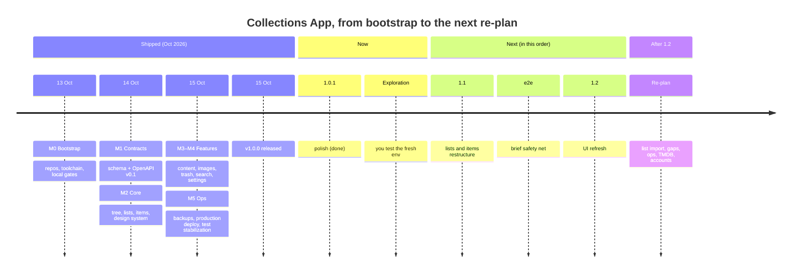

# Collections App — Product Roadmap

| | |
|---|---|
| **Owner** | Top-level orchestrator (parent repo session), approved by the product owner (you) |
| **Last updated** | 2026-10-15 |
| **Horizons** | **Now**: in flight · **Next**: committed, in order · **Pool**: committed or likely, ordered at the next re-plan · **Exploring**: ideas, no commitment |
| **Status** | ✅ shipped · 🟢 in progress · 🟡 planned · ⚪ idea · ⛔ not doing |

Target windows are **indicative**, not promises. Order within a horizon is the priority order.
Each initiative with an ID (`F-NNN`) has a feature brief in [`design-docs/features/`](design-docs/features/) once it reaches **Next**.
IDs follow creation order, not execution order: the **#** column in §2 is the order things run in.

---

## 1. Vision

A calm, image-forward place for two people to collect and compare the things they like or want: movies to watch,
motorcycles to consider, things to buy. It's private and self-hosted on a home server. Data is never lost: there's
version history, a trash with restore, and backups. It should be quick to use on a phone or a desktop.

**Product principles**
1. **Private by default.** The app is never exposed to the internet without accounts (Phase 3). Data stays on your hardware.
2. **Never lose user data.** Edits are versioned, deletes are restorable, conflicts never discard a draft, and backups are verified.
3. **Calm and lean.** Clean UI, few dependencies, no features that need maintenance without being used.
4. **Contract first.** The backend owns the OpenAPI contract, and the web app follows a pinned version.

---

## 2. At a glance

| # | Release | Theme | Status | Window |
|---|---|---|---|---|
| — | **1.0 MVP** | Organize, describe and protect a shared collection | ✅ Released `v1.0.0` (2026-10-15) | Oct 2026 |
| 1 | **1.0.1** | Polish from the release checks (F-006) | ✅ Released `v1.0.1` (2026-10-15) | Oct 2026 |
| 2 | — | Exploration session: you use the fresh test env and list what to change | 🟢 Now | Oct 2026 |
| 3 | **1.1** | Lists and items restructure (F-007): one item type per list, fewer predefined fields, list descriptions, plus the exploration findings | 🟡 Next | Q4 2026 |
| 4 | — | Brief e2e safety net (F-003) | 🟡 Next | Q4 2026 |
| 5 | **1.2** | UI refresh with your design (F-002) | 🟡 Next | Q4 2026 |
| — | later | Re-planned after 1.2 from the pool: list import, product gaps, ops hardening, CI and upkeep, TMDB (2.0), accounts (3.0) | ⚪ Pool | 2027 |

---

## 3. Now / Next / Pool

```mermaid
flowchart LR
    subgraph NOW["🟢 Now"]
        F006["F-006 · 1.0.1 polish ✅"]
        EXP["Exploration session<br/>(you, fresh test env)"]
    end
    subgraph NEXT["🟡 Next, in order"]
        F007["F-007 · 1.1 Lists & items restructure<br/>one type per list · fewer fields · list description"]
        F003["F-003 · Brief e2e safety net"]
        F002["F-002 · 1.2 UI refresh<br/>(your design)"]
    end
    subgraph POOL["⚪ Pool, ordered after 1.2"]
        IMP["List import<br/>(e.g. Markdown bullets)"]
        F004["F-004 · Product gaps"]
        F005["F-005 · Ops hardening"]
        UPK["CI & upkeep<br/>CI · upgrades · a11y"]
        P2["2.0 · TMDB + auto refresh"]
        P3["3.0 · Accounts & access control"]
    end
    F006 --> EXP --> F007 --> F003 --> F002 --> POOL
```

**Why this order.**
The restructure (F-007) changes the data model and the screens built on it: list types, item forms and list pages. Doing it
first means the e2e tests and the UI refresh are written once, against the final shape, not twice. The e2e tests come right
before the UI refresh because they're its safety net. Everything else waits for a re-plan after 1.2, when the app has its
final shape and look.

---

## 4. Shipped: 1.0 MVP (`v1.0.0`, 2026-10-15)

| Area | What you can do | Backend | Web |
|---|---|---|---|
| Organize | Nested folders, lists at the root or in folders, move with cycle protection, drag-reorder | B-06 | W-04, W-05 |
| Items | 6 kinds (generic, movie, TV show, motorcycle, car, camera) with optional per-kind fields, sort, filter, 3 display modes | B-07 | W-06, W-07, W-08 |
| Descriptions | Markdown editor with safe preview, version history and restore | B-08 | W-10 |
| Images | One per item: upload or URL, thumbnails, progress, orphan cleanup | B-09 | W-09 |
| Find | Title search with paths, Home with recent items | B-11, B-12 | W-11, W-13 |
| Undo | Trash with batch restore, restore-to, and purge | B-10 | W-12 |
| Two editors | Optimistic concurrency: conflicts never discard a draft | B-04 | W-08 |
| Look & feel | Design system, light and dark themes, responsive shell from 375 px | — | W-03, W-04, W-13 |
| Run it | `./deploy/dev`, `./deploy/test`, `./deploy/prod` (home server, images built locally, loopback/Tailscale only) | Q-03 | Q-03w |
| Protect it | Backup, restore and verify of Postgres and images together, with retention | Q-02 | — |

Contract: `api-v0.2.0`. Decisions D-001 to D-073 are in [`design-docs/DECISIONS.md`](design-docs/DECISIONS.md).

---

## 5. Now

### Exploration session 🟢
You're using `./deploy/test` (fresh) and listing what to change. The findings go into F-007.

### F-006 · 1.0.1 polish ✅
Small fixes found by the 1.0 checks and by you, all in the web app: Home and Trash go stale after a delete until reload; the
"Backend: ready" indicator moves into Settings (with the API address and contract version); Tab reachability of the
sidebar tree; focus return after Esc; delete-confirm vs Trash counts; a client-side IMDb URL check; an up-to-date web
README; a flaky `ItemEditForm` test; the prod CSP verified in a real browser.
Brief: [`design-docs/features/F-006-1.0.1-polish.md`](design-docs/features/F-006-1.0.1-polish.md). The first feature run
with the v2 workflow.

### F-001 · 1.0 release readiness ✅
Fresh-clone check (Q-04), scope and security review (Q-05: no critical or high findings), smoke checklist (C4). Tagged `v1.0.0`.

## 6. Next (in this order)

### F-007 · Lists and items restructure 🟡 · 1.1
**What:** reshape the model before anything is built on top of it. Known so far:
- **One item type per list.** A list has a single kind, chosen when it's created, and every item in it is of that kind.
- **Fewer predefined fields** per kind (today's set in PRODUCT §4.2 is too large).
- **List description:** Markdown on a list, e.g. for links that apply to all its items.
- Plus the issues found in the exploration session.

Backend and web, with a contract change (`api-v0.3.0`) and a migration of existing data.
Brief (draft, completed after the exploration): [`design-docs/features/F-007-lists-items-restructure.md`](design-docs/features/F-007-lists-items-restructure.md).

### F-003 · Brief e2e safety net 🟡
A **small** set of Playwright end-to-end tests against the real backend (`./deploy/test`), covering only the main flows
(create folder/list/item, edit, image, trash and restore, search) plus an axe check in both themes. Deliberately short: this
is a two-person app, not a test framework project. Written after F-007 so it targets the final model.

### F-002 · UI refresh 🟡 · 1.2
**What:** a large, mostly **aesthetic** refactor of the web app: a new visual design applied across every screen.
Behavior and the API stay as they are. The design comes from you, and only then does this become a brief (D-075).

**Guardrails that apply whatever the design:**
- Lean (D-034): no heavy UI kits, and the bundle shouldn't grow without a reason.
- Accessibility holds: both themes stay at zero axe violations, with keyboard paths intact.
- Behavior doesn't change; the unit tests and the F-003 e2e tests stay green.

## 7. Pool (ordered at the re-plan after 1.2)

No commitment on order until then. IDs exist only for briefs already written.

| Initiative | What |
|---|---|
| **List import** | Create a list from text, e.g. a Markdown bullet list (one item per bullet). Format and rules to be defined |
| **F-004 · Product gaps** | Paste an image from the clipboard onto an item; "Empty trash" with confirmation; optional trash auto-purge after N days (off by default) |
| **F-005 · Ops hardening** | Strip EXIF (GPS) from uploads; your backup → wipe → restore drill (moved from F-006 U1); `make audit` / `npm run audit` before each tag; scheduled backup on the Pi plus a quarterly restore drill; exposure check for the local stack; 40 MP and slow-network upload checks |
| **CI & upkeep** | GitHub Actions running the gates + Dependabot (D-031 deferred it); Node 26 LTS (from 2026-10-28, D-042) and TypeScript 7 when typescript-eslint supports it (D-040); VoiceOver pass on drag-and-drop and a keyboard context menu on tree rows (W-05); verify `VITE_API_MOCKS=1` in a browser (W-02) |
| **2.0 · TMDB + automatic refresh** | Movie and TV lookup when creating an item, metadata refresh, streaming availability by country, attribution, rate limits. User-entered values are never silently overwritten. No IMDb scraping. Starts with a check of current TMDB terms. Fits the F-007 model (a movie list gets TMDB lookup) |
| **3.0 · Accounts & access control** | Users, memberships, authorization; every table already carries `workspace_id` (revisit `item_content_versions`, Q-05 finding 5). **The gate before any exposure beyond the private network** |

---

## 8. Exploring (no commitment)

| Idea | Notes |
|---|---|
| Public API | Needs a full re-discussion first (PRODUCT §13, Phase 4) |
| Real-time collaborative Markdown | Path kept open: Yjs + CodeMirror 6, content already versioned in Postgres (ARCHITECTURE §7) |
| Mobile app | Same pinned OpenAPI contract, separate repo |
| AI assist | Description drafts, comparisons, Q&A. Only with explicit approval before anything is saved. Very distant |
| Multiple images per item | `attachments` is already independent of `items`, so it's additive |
| Advanced search | Search inside Markdown and metadata, saved filters |
| Offline mode, rich-text editor, version diffs, custom workflows | Deferred since the MVP, no current demand |
| Comparison view | Side by side of 2–4 items in a list (fits "things we are comparing") |

## 9. Not doing ⛔
- Exposing the app to the internet before 3.0.
- A monorepo, microservices, Redis, queues, an ORM (ORCHESTRATOR_BRIEF §2).
- Scraping IMDb or any provider that doesn't allow it.

## 10. Open questions
| ID | Question | Default |
|---|---|---|
| Q-4 | License for the repos? | No LICENSE (all rights reserved) |

---

## How this roadmap is maintained
- The **top-level orchestrator** (a session in this parent repo) owns this file. It turns an initiative into a feature brief
  in `design-docs/features/F-NNN-*.md` with user stories per repo, when it moves to **Next** and you approve it.
- The **repo orchestrators** split stories into tasks and run them with internal worker agents
  ([`design-docs/AGENT_WORKFLOW.md`](design-docs/AGENT_WORKFLOW.md) §1b). Progress is tracked in [`design-docs/STATUS.md`](design-docs/STATUS.md).
- This file is updated when a feature ships, starts, or changes horizon. Detailed task history stays in STATUS.md.

## Changelog
- 2026-10-15: **v1.0.1 released** (F-006 polish); the exploration session starts. Backup drill (U1) moved to F-005.
- 2026-10-15: **Re-plan.** Next is now, in order: exploration session → F-007 lists and items restructure (1.1) → brief e2e (F-003, cut to e2e only) → UI refresh (F-002, 1.2). List import added. F-004, F-005, CI and upkeep, 2.0 and 3.0 move to a pool ordered after 1.2 (D-078).
- 2026-10-15: **v1.0.0 released.** Workflow v2 started. F-006 (1.0.1 polish) is Now; F-001 done.
- 2026-10-15: Q-04 done. F-002 made generic: the design comes from you later (D-075). The v2 workflow starts after Q-05 + C4.
- 2026-10-15: Roadmap created. 1.0 feature-complete; F-001 to F-005 defined; UI refresh (F-002) added.
