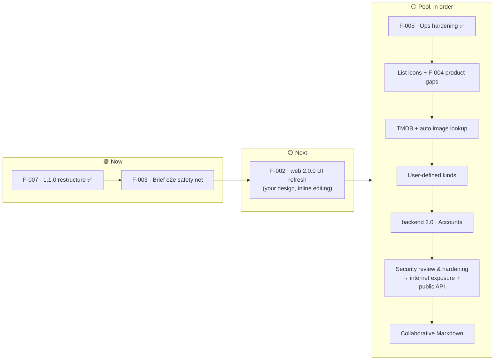

# Collections App — Product Roadmap

| | |
|---|---|
| **Owner** | Top-level orchestrator (parent repo session), approved by the product owner (you) |
| **Last updated** | 2026-10-15 |
| **Horizons** | **Now**: in flight · **Next**: committed, in order · **Pool**: committed, proposed order fixed at the next re-plan · **Future**: on the roadmap, not ordered · **Exploring**: uncertain concepts, no commitment |
| **Status** | ✅ shipped · 🟢 in progress · 🟡 planned · ⚪ idea · ⛔ not doing |

Target windows are **indicative**, not promises. Order within a horizon is the priority order.
Each initiative with an ID (`F-NNN`) has a feature brief in [`design-docs/features/`](design-docs/features/) once it reaches **Next**.
IDs follow creation order, not execution order: the **#** column in §2 is the order things run in.

---

## 1. Vision

A calm, image-forward place for two people to collect and compare the things they like or want: movies to watch,
motorcycles to consider, things to buy. It's private and self-hosted on a home server. Data is never lost: there's
version history, a trash with restore, and backups. It should be quick to use on a phone or a desktop.

**Product principles**
1. **Private by default.** The app is never exposed to the internet before accounts and a thorough security review and hardening. Data stays on your hardware.
2. **Never lose user data.** Edits are versioned, deletes are restorable, conflicts never discard a draft, and backups are verified.
3. **Calm and lean.** Clean UI, few dependencies, no features that need maintenance without being used.
4. **Contract first.** The backend owns the OpenAPI contract, and the web app follows a pinned version.

---

## 2. At a glance

| # | Release | Theme | Status | Window |
|---|---|---|---|---|
| — | **1.0 MVP** | Organize, describe and protect a shared collection | ✅ Released `v1.0.0` (2026-10-15) | Oct 2026 |
| 1 | **1.0.1** | Polish from the release checks (F-006) | ✅ Released `v1.0.1` (2026-10-15) | Oct 2026 |
| 2 | — | Exploration session: you used the fresh test env and listed what to change | ✅ Done (2026-10-15) | Oct 2026 |
| 3 | **1.1.0** | Lists and items restructure + exploration fixes (F-007): one kind per list, trimmed fields, addable price, list description, 6 UI fixes. Last shared version (D-080) | ✅ Released `v1.1.0` (2026-10-15) | Oct 2026 |
| 4 | — | Brief e2e safety net (F-003): `make smoke` + ~8 Playwright specs | ✅ Done (2026-10-15) | Oct 2026 |
| 5 | **web 2.0.0** | UI refresh (F-002): Frosted Gallery design, in-place item editing, quick add, streaming icons; run from a sister session | ✅ Released `v2.0.0` (2026-10-15) | Q4 2026 |
| 6 | **web 2.1.0** | UI polish after the first look at 2.0.0 (F-008): top bar (search + quick add + theme), consistent radii and toolbar, keyboard selection, drag into folders, inline new item, title area, links row with real icons, one price field, initials, generic lists without fields | ✅ Done (2026-10-16) | Oct 2026 |
| 7 | **web 2.2.0** | UI polish 2 (F-009): price only on kinds that have it, ordered pinned fields, Move/Delete at the bottom, one icon tile, cleaner streaming row, centred empty Trash | ✅ Merged 2026-10-16 (2.2.0 bumped in #39, tag pending) | Oct 2026 |
| 8 | **backend 1.4.0 + web 2.3.0** | List icons (emoji or built-in, searchable, coloured), paste an image, empty trash, trash auto-purge (F-012, `api-v0.8.0`) | ✅ Released `v1.4.0`, `v2.3.0` (2026-10-16) | Oct 2026 |
| 9 | **backend 1.5.0 + web 2.4.0** | TMDB lookup: smart title match, auto-filled fields, poster, director (sort/filter), metadata language, attribution (F-013, `api-v0.9.0`) | ✅ Released `v1.5.0`, `v2.4.0` (2026-10-17) | Oct 2026 |
| 10 | **backend 1.6.0 + web 2.5.0** | Custom fields and custom kinds, defined per kind in Settings → Kinds & fields; pin, sort and filter on any field; built-in kinds become locked data (F-014, `api-v0.10.0`/`0.10.1`; fixes `v1.6.1`) | ✅ Released `v1.6.0`, `v2.5.0` (2026-10-19) | Oct 2026 |
| 11 | **backend 2.0.0 + web 2.6.0** | Settings rework; "kind" becomes "type"; lists can have no type; price follows the type definition (F-015, `api-v0.11.0`, breaking) | ✅ Released `v2.0.0`/`v2.0.1`, `v2.6.0` (2026-10-19) | Oct 2026 |
| 12 | **backend 2.4.0 + web 2.13.1** | **Books type** with lookup (Open Library + Hardcover), store and streaming links, up to 3 pins (F-016, `api-v0.12.0` to `0.15.0`, many follow-ups) | ✅ Done (2026-10-19/20) | Oct 2026 |
| 13 | backend 2.5.0 + web 2.14.0 | **Type refactor** (F-018): five plural built-ins, no-type list glyph, icon editing from the header and sidebar | ✅ Done (2026-10-20) | Oct 2026 |
| 14 | backend 2.6.0 | **Backend architecture refactor** (F-019): layers (handler → service → repository), simple queries, soft deletes, one baseline migration, code-first generated OpenAPI (`api-v1.0.0`) | ✅ Done (2026-10-31, backend 2.6.0, `api-v1.0.0`/`api-v1.0.1`) | Oct–Nov 2026 |
| 15 | web 2.18.0 | **Web architecture refactor** (F-020): feature slices with lint-enforced boundaries, big files split, one data layer, link building moves from the backend to the web | ✅ Done (2026-10-31, web 2.18.1) | Oct–Nov 2026 |
| 16 | web | **Icon audit and fix** (F-017): every link, store and streaming icon correct; per-icon official SVGs (no single pack covers all, checked), one registry, one tile size | ✅ Done (2026-10-30, web 2.19.0 and 2.19.1) | Oct 2026 |
| 17 | web 2.20.0 | **Web restyle "Editorial"** (F-021): new tokens, type scale and self-hosted fonts across every screen, no behaviour change | ✅ Done (2026-10-30, web 2.20.0, web#96, D-111) | Oct 2026 |
| 18 | **backend 2.7.0 + web 2.21.0** | **Simplify and my services** (F-022): custom types and pin settings removed, owned streaming services in Settings, missing icons and white tiles | ✅ Done (backend 2.7.0 `api-v2.0.0` backend#66; web 2.21.0 web#103; D-112, D-113) | Nov 2026 |
| 19 | **backend 2.8.0 + web 2.22.0** | **No custom fields** (F-023): Settings "Types & fields" and custom fields removed; types are code; backend treated as not yet started (one baseline schema, no migrations) | ✅ Done (backend 2.8.0 backend#67; web 2.22.0 web#105; D-114, D-115) | Nov 2026 |
| 20 | **deploy + backend 2.8.1–2.8.3 + web 2.22.1–2.22.2** | **Raspberry Pi prod** (F-024): Pi 3B+ on the LAN, GHCR arm64 images, per-repo GitHub Releases as prod approval, one-minute release check, migrations in the api image, preflight on a DB copy and health-gated rollback (D-116 to D-118) | ✅ Live 2026-11-03 | Nov 2026 |
| 21 | deploy | **Off-Pi backups to Google Drive** (rclone, encrypted, token authorised on the Mac) | ✅ Done 2026-11-04 (rclone crypt, nightly upload, 30 kept) | Nov 2026 |
| 22 | deploy | **Test stack on the Pi**: GitHub pre-releases deploy to a separate, empty test stack on port 8081 (`./deploy/pitest`); prod keeps the release marked latest (D-119) | ✅ Done 2026-11-04 (live on 8081) | Nov 2026 |
| 23 | web | **Mobile fixes** (F-025): no zoom on focus, one-row list toolbar, compact header, sidebar padding, long press for Move/Delete with drag reorder kept, smaller link icons, drop the manual-sorting hint | ✅ Done 2026-11-05 (web 2.23.0–2.28.1, backend 2.8.4–2.10.0) | Nov 2026 |
| 23b | backend + web | **List polish, availability filters, unique titles** (F-026) | ✅ Done 2026-11-05 (backend 2.11.0–2.11.2, web 2.29.0, D-126, D-127) | Nov 2026 |
| 24 | deploy | **Alerts via healthchecks.io**: failed deploy or rollback, failed or stale backup, release check stuck, disk or memory low, prod container unhealthy, Pi offline | ✅ Done 2026-11-05 | Nov 2026 |
| 25 | deploy + backend | **Hosted logs and latency charts** (light agent shipping to a free hosted dashboard; lifts the "no metrics" rule) | ✅ Done 2026-11-05 (D-128) | Nov 2026 |
| 26 | local doc | **Pi operations guide** (kept only on your machine, not in git): full setup from an empty SD card, how the repos sit on the Pi, push vs release, where the logs are, runbooks for failures, re-setup from scratch, restore from Google Drive | ✅ Done 2026-11-06 (~/Desktop/Collections Pi Guide) | Nov 2026 |
| 27 | backend + web | **Chores and home-screen app**: deploy docs rewritten, image pruning after deploys, tmdb client split, default name "Collections" (backend 2.11.3), iPhone home-screen web app with manifest and icons (web 2.30.0) | ✅ Done 2026-11-06 (D-131) | Nov 2026 |
| 28 | backend + web | **Fixes round (phone feedback)**: clickable links with site favicons in expanded items and on the item row, "Validation failed" on Fantasia titles, Markdown edit buttons under the box + reliable copy/paste on iOS, website link ellipsis, list icon picker (no emoji preview, color next to icon), no description collapse, blurred top in the home-screen app, localized book authors (+ refresh feasibility) | 🔨 Now (backend done: 2.12.0 / api-v3.3.0, backend#84; authors not localizable, D-132; web 2.32.0–2.34.0 done, web#126–#128, D-133..D-139; awaiting phone check of keyboard and status bar) | Nov 2026 |
| 29 | ops (you) | **Move the Pi to another room**: clean shutdown, keep 192.168.1.75 (move the router reservation if switching cable/wifi), check app + healthchecks | 📋 Next, scheduled later | — |
| 30 | deploy + web | **Remote access**: Cloudflare Tunnel (`cloudflared` on the Pi, optional via `TUNNEL_TOKEN`) + Cloudflare Access on `collections.federama.dev`, login limited to your emails; federama.dev DNS moves to Cloudflare (GitHub Pages records kept); manifest link gets `crossorigin="use-credentials"`. Replaces offline viewing | 📋 Next, you start it later | — |
| — | future | Development paused 2026-11-06. Future improvements: accounts (backend 3.0), security review + internet exposure + public API, collaborative Markdown, list import, advanced search | 🔭 Future | — |

---

## 3. Now / Next / Pool

**Why this order.**
The restructure (F-007) changes the data model and the screens built on it: list types, item forms and list pages. Doing it
first means the e2e tests and the UI refresh are written once, against the final shape, not twice. The e2e tests come right
before the UI refresh because they're its safety net. Everything else waits for a re-plan after the UI refresh, when the app has its
final shape and look.

---

## 4. Shipped: 1.0 MVP (`v1.0.0`, 2026-10-15)

| Area | What you can do | Backend | Web |
|---|---|---|---|
| Organize | Nested folders, lists at the root or in folders, move with cycle protection, drag-reorder | B-06 | W-04, W-05 |
| Items | 6 kinds (generic, movie, TV show, motorcycle, car, camera) with optional per-kind fields, sort, filter, 3 display modes | B-07 | W-06, W-07, W-08 |
| Descriptions | Markdown editor with safe preview, version history and restore | B-08 | W-10 |
| Images | One per item: upload or URL, thumbnails, progress, orphan cleanup | B-09 | W-09 |
| Find | Title search with paths, Home with recent items | B-11, B-12 | W-11, W-13 |
| Undo | Trash with batch restore, restore-to, and purge | B-10 | W-12 |
| Two editors | Optimistic concurrency: conflicts never discard a draft | B-04 | W-08 |
| Look & feel | Design system, light and dark themes, responsive shell from 375 px | — | W-03, W-04, W-13 |
| Run it | `./deploy/dev`, `./deploy/test`, `./deploy/prod` (home server, images built locally, loopback/Tailscale only) | Q-03 | Q-03w |
| Protect it | Backup, restore and verify of Postgres and images together, with retention | Q-02 | — |

Contract: `api-v0.2.0`. Decisions D-001 to D-073 are in [`design-docs/DECISIONS.md`](design-docs/DECISIONS.md).

---

## 5. Now

### F-003 · Brief e2e safety net ✅
`make smoke` on the backend (one HTTP pass over the running stack) and about 8 Playwright specs on the web (organize,
item with price, description history, image, conflict, trash, search and links, a reduced axe pass in both themes).
Not part of the gate; run on user-flow changes and before a release (D-076). Lean workflow (D-081).
Brief: [`design-docs/features/F-003-e2e-safety-net.md`](design-docs/features/F-003-e2e-safety-net.md).

### F-007 · Lists and items restructure + exploration fixes ✅ · 1.1.0
Merged 2026-10-15 (backend#18, web#28, `api-v0.3.0`). One kind per list (no per-item kind), common fields trimmed to title, image, website and description,
price addable on demand (single or range), essential kind fields with a per-kind sort key, Markdown list description, and
the 6 exploration fixes (no "collections" wording, folder rows without arrow, no move up/down on folders, one description,
no breadcrumbs, appearance toggle in the sidebar). Contract `api-v0.3.0`. Run with the one-off lean workflow (D-079).
Both repos ship **1.1.0**, the last shared version (D-080).
Brief: [`design-docs/features/F-007-lists-items-restructure.md`](design-docs/features/F-007-lists-items-restructure.md).

### Exploration session ✅
You used `./deploy/test` (fresh) and listed what to change; the findings went into F-007, the rest into F-002 and the pool.

### F-006 · 1.0.1 polish ✅
Small fixes found by the 1.0 checks and by you, all in the web app: Home and Trash go stale after a delete until reload; the
"Backend: ready" indicator moves into Settings (with the API address and contract version); Tab reachability of the
sidebar tree; focus return after Esc; delete-confirm vs Trash counts; a client-side IMDb URL check; an up-to-date web
README; a flaky `ItemEditForm` test; the prod CSP verified in a real browser.
Brief: [`design-docs/features/F-006-1.0.1-polish.md`](design-docs/features/F-006-1.0.1-polish.md). The first feature run
with the v2 workflow.

### F-001 · 1.0 release readiness ✅
Fresh-clone check (Q-04), scope and security review (Q-05: no critical or high findings), smoke checklist (C4). Tagged `v1.0.0`.

## 6. Next (in this order)

### F-009 · UI polish 2 ✅ · web 2.2.0 + backend 1.3.0
Second polish round after the look at 2.1.0: price only on the kinds that have it, pinned fields as an ordered list of
two, Move and Delete at the bottom of the item, one icon tile for every link and streaming service, a cleaner streaming
row, and a centred empty Trash. Contract `api-v0.7.0`. Brief: [`design-docs/features/F-009-ui-polish-2.md`](design-docs/features/F-009-ui-polish-2.md).

### F-008 · UI polish ✅ · web 2.1.0 + backend 1.2.2
Your first look at 2.0.0: 14 web stories and one backend story (generic lists lose price), checked against Apple's HIG.
Runs before pool item 3. Brief: [`design-docs/features/F-008-ui-polish.md`](design-docs/features/F-008-ui-polish.md).

### F-002 · UI refresh ✅ · web 2.0.0
**Status 2026-10-15:** design direction **Frosted Gallery** chosen (Apple-inspired, layered, plain colour) and the brief approved (design finished with the user): [`design-docs/features/F-002-ui-refresh.md`](design-docs/features/F-002-ui-refresh.md) (stories per repo; one backend story for paid streaming platforms, the rest web). The inputs below are all folded into it.

**What:** a large refactor of the web app: a new visual design applied across every screen, plus the interaction changes
below. The API stays as it is unless the design needs something small. The web becomes 2.0.0; the backend keeps its own
version (D-080). The design comes from you (D-075).

**Run from a separate session:** the UI rework is designed, planned and orchestrated from a sister top-level session in this
same folder, which drives its own web/backend sessions. This main session doesn't plan or start it; it only keeps this
section and the roadmap current.

**Inputs collected so far (from you, 2026-10-15):**
- **No edit mode at all.** An item is edited directly in its side page (the item detail panel): no separate "Edit" panel,
  no big form with every field. Each field shows a small pen in its top-right corner on hover and is edited in place; the
  Markdown description is edited by selecting it in the page; "+" adds a field that isn't shown yet (e.g. price, as a single
  price or a range, F-007).
- **Drag folders and lists from anywhere on the row**, without the six-dot grip handle.
- Already done in F-007 (keep them): no "collections" wording, folder rows without the expand arrow (folder icon opens and
  closes), no move up/down on folders, one description shown only in the item detail, no breadcrumbs, the appearance toggle
  in the sidebar.
- Known follow-ups from F-007 the redesign can absorb: the list kind is changed from the Rename dialog (not an obvious
  place); a single price renders as `€1,200`.

**Guardrails that apply whatever the design:**
- Lean (D-034): no heavy UI kits, and the bundle shouldn't grow without a reason.
- Accessibility holds: both themes stay at zero axe violations, with keyboard paths intact (in-place editing and
  drag-from-anywhere need keyboard equivalents).
- Behavior changes only where listed above. The unit tests and the F-003 e2e tests stay green; specs that drive the old
  edit form (item, conflict AT-09, unsaved-changes guard AT-22) are updated to the in-place editing, not dropped.

## 7. Pool (in order, after the UI refresh)

Committed, in this order (set by you, 2026-10-15), after the UI refresh. The re-plan after F-002 only adjusts it if needed. Web and backend version independently (D-080).

| # | Initiative | What | Likely version |
|---|---|---|---|
| 1–2 | **F-005 · Ops hardening** ✅ | Strip EXIF/GPS from uploaded originals + backfill (backend); scheduled nightly backup with systemd and `./deploy/prod backup-status` (parent, done); audits before every tag (D-084). Brief: [`F-005-ops-hardening.md`](design-docs/features/F-005-ops-hardening.md) | backend 1.2.1 |
| — | **Upkeep (later)** | Flaky drag-reorder e2e (stabilise or quarantine), Node 26 LTS (from 2026-10-28, D-042), TypeScript 7 when typescript-eslint supports it (D-040), VoiceOver pass on drag-and-drop (W-05), `VITE_API_MOCKS=1` browser check (W-02); your backup → wipe → restore drill; exposure check script; 40 MP and slow-network upload checks. Done as small chores when due | patch bumps; icon packs: SVG brand packs for every link and streaming service (vendored, never fetched at runtime) |
| 3 | **List icons + F-004 product gaps** (brief: F-012) | An interchangeable icon per list: an emoji or one from a built-in icon set (Notion-style, no photos), the current icon as default. Paste an image from the clipboard (copy an image or take a screenshot, then Cmd+V on an item to set it as its image, without saving a file first); "Empty trash" with confirmation; optional trash auto-purge after N days (off by default) | backend 1.2 / web 2.1 |
| 4 | **TMDB + automatic image lookup** (brief: F-013) | Movie and TV lookup when creating an item, metadata refresh, streaming availability by country, attribution, rate limits; an image fetched automatically when an item is added (TMDB for movies and TV, another provider to check for the other kinds). User-entered values are never silently overwritten. No IMDb scraping. Starts with a check of the providers' terms | backend 1.3 / web 2.2 |
| 5 | **Custom fields + custom types** (brief: F-014) | Two steps, wanted by the user (2026-10-15): **(a) custom fields on any list**, e.g. a *Director* on a movie list, shown in the item, **pinnable** in rows (F-002 stores pinned fields by key for this) and usable to **filter and sort** (today the filter is title-only); **(b) custom types**: create your own item kinds with their own fields, sort key, default pinned fields and links, replacing the fixed kind list. Fits the validator registry + `metadata` JSONB, but needs field and kind definitions stored per workspace/list | backend 1.4 / web 2.3 |
| 6 | **Accounts & access control** | Users, memberships, authorization; every table already carries `workspace_id` (revisit `item_content_versions`, Q-05 finding 5) | **backend 3.0** / web 3.0 |
| 7 | **Security review & hardening → internet exposure + public API** | A thorough security review and hardening pass (threat model, auth/session review, rate limiting, headers, dependency and container audit, pentest-style checks). Internet exposure and a public API happen only after it, or within it. The public API needs a full re-discussion first (PRODUCT §13, Phase 4) | after backend 2.0 |
| 9 | **Real-time collaborative Markdown** | Two people editing the same description live. Path kept open: Yjs + CodeMirror 6, content already versioned in Postgres (ARCHITECTURE §7) | after #8: needs accounts for presence and names |

## 8. Future (on the roadmap, not yet ordered)

| Idea | Notes |
|---|---|
| List import | Create a list from text, e.g. a Markdown bullet list (one item per bullet). Format and rules to be defined |
| Advanced search | Search inside Markdown descriptions and kind fields, saved filters |
| Books lookup | Automatic lookup and cover for book lists, from a provider to be chosen (Open Library or Google Books); asked for 2026-10-16 after the TMDB brief |

## 9. Exploring and not on the roadmap

**Exploring (a possible new concept, not sure yet):**
| Idea | Notes |
|---|---|
| Compare & AI assist | A separate, future concept: side-by-side comparison of 2–4 items, with AI help (drafts, comparisons, Q&A) only with explicit approval before anything is saved. To be defined from scratch, if ever |

**Not on the roadmap for now:**
- **Mobile app.** Only after accounts and once the app is public; same pinned OpenAPI contract, separate repo.
- **Multiple images per item.**
- Offline mode, rich-text editor, version diffs, custom workflows (deferred since the MVP, no demand).

**Not doing ⛔**
- CI (GitHub Actions) and Dependabot, for now (D-084): gates run locally, audits before each tag.
- Exposing the app to the internet, or publishing an API, before the security review and hardening (pool item 8), which itself comes after accounts.
- A monorepo, microservices, Redis, queues, an ORM (ORCHESTRATOR_BRIEF §2).
- Scraping IMDb or any provider that doesn't allow it.

## 10. Open questions
| ID | Question | Default |
|---|---|---|
| Q-4 | License for the repos? | No LICENSE (all rights reserved) |

---

## How this roadmap is maintained
- The **top-level orchestrator** (a session in this parent repo) owns this file. It turns an initiative into a feature brief
  in `design-docs/features/F-NNN-*.md` with user stories per repo, when it moves to **Next** and you approve it.
- The **repo orchestrators** split stories into tasks and run them with internal worker agents
  ([`design-docs/AGENT_WORKFLOW.md`](design-docs/AGENT_WORKFLOW.md) §1b). Progress is tracked in [`design-docs/STATUS.md`](design-docs/STATUS.md).
- This file is updated when a feature ships, starts, or changes horizon. Detailed task history stays in STATUS.md.

## Changelog
- 2026-11-01: **App in use (D-116):** baseline frozen as migration 1.0; one migration per feature, edited in place until released; dev/test vs prod, prod releases only after your yes in chat. Next: accounts (migration 1.1).
- 2026-11-01: **F-023 backend done** (backend 2.8.0, backend#67, `api-v3.0.0`, D-114; 2.x because 3.0.0 is reserved for accounts): custom fields, the five field operations and the `type_definitions`/`type_fields` tables removed; built-in types are code; `GET /types` kept from the registry. Baseline schema edited in place: reset dev and test DBs. Next: F-023 W1. TMDB check: the Apple subscription is now named "Apple TV" (id 350), the store "Apple TV Store" (id 2); "Amazon Prime Video with Ads" (id 2100) and the "… Amazon Channel" entries do not resolve in the web registry yet (web follow-up).
- 2026-11-01: **F-023 web done** (web 2.22.0, web#105, pointer `d37ecf4`, D-115): Settings "Types & fields" and custom-field UI removed, sort/filter on built-in fields only, code adapted to `api-v3.0.0`; type definitions still read from `GET /types` (cached for the session), so `listTypes` stays. Also TMDB "Amazon Prime Video Free with Ads" (613) → Prime Video. F-023 complete.
- 2026-10-16: **F-009 merged** (backend 1.3.0 / api-v0.7.0 tagged; web#37 squashed `80a40bb` incl. F-010 new-list folder and F-011 review fixes). Web 2.2.0 bumped (web#39, audit clean); tag v2.2.0 pending.
- 2026-10-19: **Before the pool, three items added by you:** (1) Books type with automatic lookup (F-016, briefed), (2) icon audit and fix (F-017), (3) type refactor (F-018, to be defined). Order: F-016, then F-017, then F-018.
- 2026-11-01: **F-022 web done** (web 2.21.0, web#103, pointer `9ddce37`): custom-type UI and Pinned control removed (fixed pins per type in the web), "My streaming services" in Settings > Media filters item and row streaming (empty = all), Apple TV Store / Amazon Video reuse the Apple TV+ / Prime Video marks, Chili added, every inset mark on a white tile. F-022 complete. Open: check TMDB's live name for the Apple store ("Apple TV" vs "Apple TV Store").
- 2026-11-01: **F-022 backend done** (backend 2.7.0, backend#66, `api-v2.0.0`, D-112): custom types and pinned-field config removed, `owned_streaming_services` in settings. Baseline migration edited in place: reset dev DBs. Next: F-022 web.
- 2026-10-30: **F-021 web restyle "Editorial" done** (web 2.20.0, web#96, D-111). Next: the pool (accounts → security review → collaborative Markdown).
- 2026-10-30: **Collaborative Markdown moved after the security review** (you, 2026-10-30): pool is now accounts → security review/exposure → collaborative Markdown. **Frontend restyling** is next, chosen with the web orchestrator.
- 2026-10-30: F-017 follow-up shipped as web 2.19.1 (D-110 display order); flaky drag-reorder e2e added to Upkeep.
- 2026-10-30: **F-017 done** (web 2.19.0, web#94, D-109): 34 SVG icons behind one registry, picker 7 → 19 services; Amazon and Apple Books from Wikimedia Commons, brand rasters embedded as SVG wrappers. Next: the pool (collaborative Markdown → accounts → security review).
- 2026-10-30: dev DB reset on the new baseline. **F-017 icons planned:** Simple Icons lacks Amazon, Prime Video, Disney+, Kobo, Bookshop.org, Open Library, Apple Books, TIMvision, Infinity, RaiPlay and others, so icons are sourced as per-icon SVGs (official sources first) behind one registry.
- 2026-10-31: **F-019 and F-020 done** (D-108): backend 2.6.0 with a generated contract `api-v1.0.0`/`1.0.1`, layers and one baseline migration; web 2.18.1 with feature slices and the links moved to the web. Housekeeping done 2026-10-30. Next: F-017 icon audit, then the pool (collaborative Markdown → accounts → security review).
- 2026-10-21: F-018 done. **Architecture refactor added before the icon work (F-017):** F-019 backend (layers/DAO, simple queries, soft deletes, one baseline migration, code-first OpenAPI `api-v1.0.0`) and F-020 web (feature slices, big files split, one data layer, link building moves to the web). Prod unused, so no compatibility; behaviour preserved, e2e unchanged.
- 2026-10-20: F-016 done (many follow-ups, backend 2.4.0 / `api-v0.15.0`, web 2.13.1). **F-018 type refactor planned and moved before F-017** (icons), at your request: five plural built-ins, camera removed, motorcycle + car → Vehicles, no-type list icon, icon edit moved.
- 2026-10-19: **F-015 done** (your changes: Settings rework, kind → type, lists without a type; backend 2.0.0/2.0.1, web 2.6.0, `api-v0.11.0`). D-094 records it; accounts become backend 3.0 / web 3.0.
- 2026-10-19: **F-014 done** (custom fields + custom kinds; backend 1.6.0/1.6.1, web 2.5.0, `api-v0.10.1`); pool item 5 shipped. The pool is up for a re-plan before the next item.
- 2026-10-17: **F-012 and F-013 done** (backend 1.4.0/1.5.0, web 2.3.0/2.4.0, `api-v0.8.0`/`api-v0.9.0`); pool items 3 and 4 shipped. Next: pool item 5, custom fields + types. Worker tiers are AI agnostic (D-087). Web `v2.2.0` was never tagged (2.3.0 followed it).
- 2026-10-16: **F-008 done**; **F-009 UI polish 2** added as Next (web 2.2.0, backend 1.3.0, api-v0.7.0). Icon packs added to Upkeep.
- 2026-10-15: **F-008 UI polish** added as Next (web 2.1.0, backend 1.2.2), before pool item 3.
- 2026-10-15: **F-005 done**: backend `v1.2.1` (metadata stripped from uploads + `strip-images` backfill), nightly backup timer, `backup-status`, audits before tags. Next: pool item 3, list icons + F-004 product gaps.
- 2026-10-15: backend tagged `v1.2.0` (F-002 backend features), parent `v2.0.0` message names both versions. Pool items 1–2 merged into **F-005 ops hardening** (Now): EXIF strip, scheduled backups + `backup-status`, audits before tags; no CI or Dependabot (D-084); remaining upkeep done as chores when due.
- 2026-10-15: **web 2.0.0 released** (F-002 Frosted Gallery, in-place editing; backend contract `api-v0.5.0`, parent tag `v2.0.0`). D-083 records the web interaction rules. Next: pool item 1.
- 2026-10-15: **v1.1.0 released** (parent + web tags; backend tagged earlier). **F-003 done** (backend#19 `make smoke`, web#29 Playwright). F-002 UI rework is Now, in a sister session (design first).
- 2026-10-15: **Pool order set by you:** UI refresh → CI & upkeep → ops hardening → list icons + gaps → TMDB + auto images → user-defined kinds → collaborative Markdown → accounts → security review. List import moves to Future. F-002 gets the inputs collected so far (no edit mode, edit in the item side page) and is run from a sister session.
- 2026-10-15: **Pool re-shaped.** Proposed order: CI & upkeep → ops hardening → list icons + gaps → TMDB + auto images → list import → user-defined kinds → collaborative Markdown → accounts (backend 3.0) → security review & hardening, which gates internet exposure and the public API. Advanced search is Future. Compare + AI assist becomes one uncertain future concept. Mobile app and multiple images per item are off the roadmap for now.
- 2026-10-15: **F-007 merged** (1.1.0, `api-v0.3.0`); PRODUCT and DATA_MODEL updated. **F-003 approved and Now**: `make smoke` + ~8 Playwright specs, lean workflow (D-081).
- 2026-10-15: **Exploration done, F-007 approved** (1.1.0, Now): restructure + 6 UI fixes, one-off lean workflow (D-079). Versions diverge after 1.1.0: UI refresh = web 2.0.0, TMDB stays backend 1.x, accounts = backend 2.0 (D-080). Pool gains list icons and automatic image lookup; F-002 gains inline editing and drag-from-anywhere; user-defined kinds in Exploring.
- 2026-10-15: **v1.0.1 released** (F-006 polish); the exploration session starts. Backup drill (U1) moved to F-005.
- 2026-10-15: **Re-plan.** Next is now, in order: exploration session → F-007 lists and items restructure (1.1) → brief e2e (F-003, cut to e2e only) → UI refresh (F-002, 1.2). List import added. F-004, F-005, CI and upkeep, 2.0 and 3.0 move to a pool ordered after 1.2 (D-078).
- 2026-10-15: **v1.0.0 released.** Workflow v2 started. F-006 (1.0.1 polish) is Now; F-001 done.
- 2026-10-15: Q-04 done. F-002 made generic: the design comes from you later (D-075). The v2 workflow starts after Q-05 + C4.
- 2026-10-15: Roadmap created. 1.0 feature-complete; F-001 to F-005 defined; UI refresh (F-002) added.
